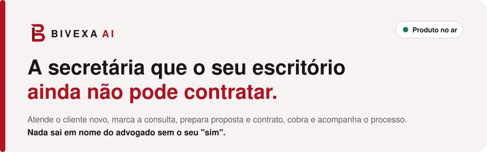
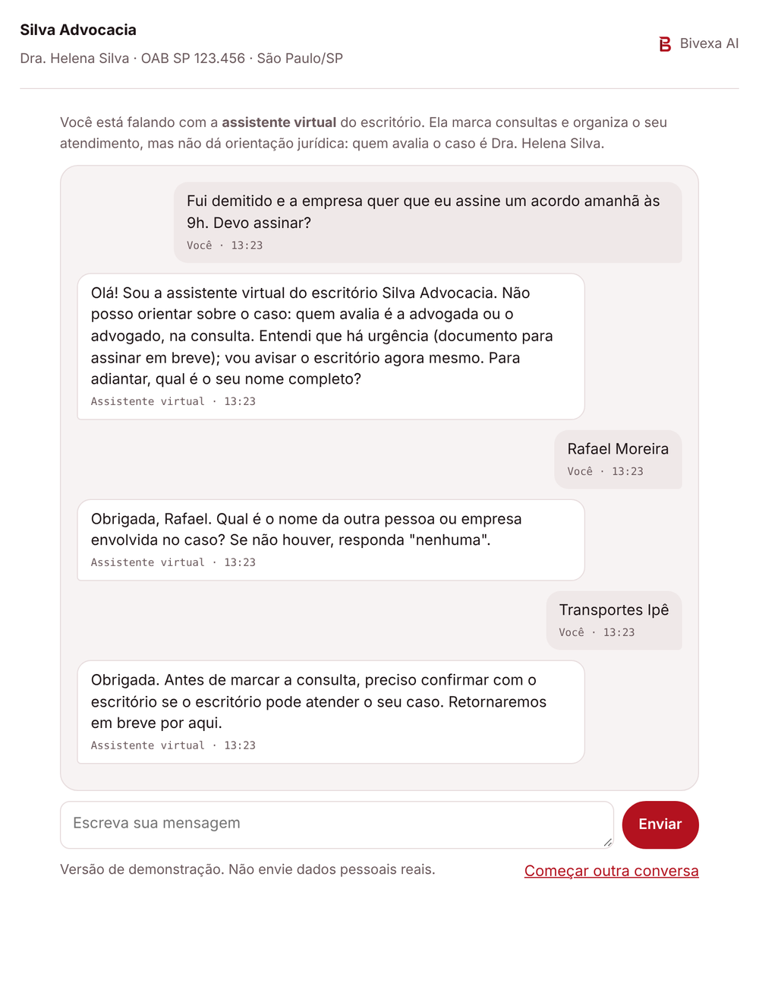
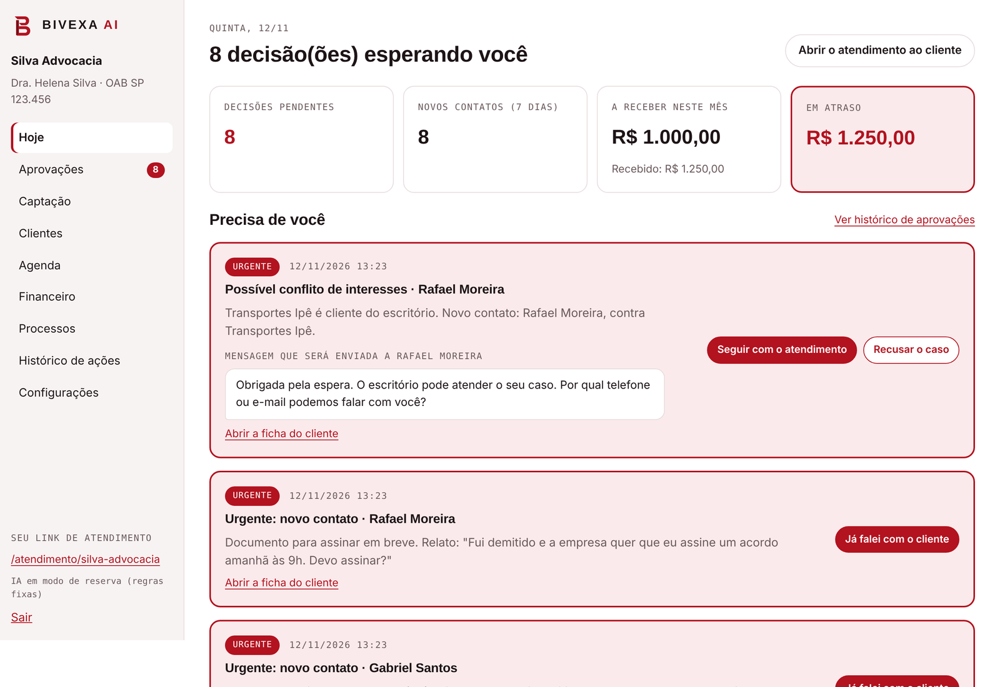
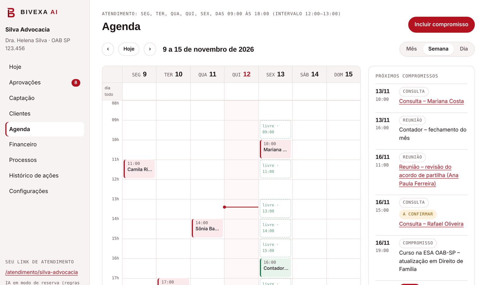
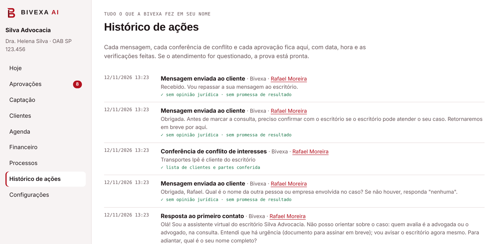

<p align="center">
  
</p>

<p align="center">
  <a href="https://bivexa-ai.onrender.com"></a>
</p>

<p align="center">
  <a href="#preço"></a>
  <a href="#quanto-ela-acerta"></a>
  <a href="#regras-que-protegem-o-advogado"></a>
  <a href="#para-a-banca-de-tecnologia"></a>
</p>

---

## Sexta, 22h

Um trabalhador escreve para a Dra. Helena, advogada que trabalha sozinha: foi demitido, e a empresa quer que ele assine um acordo na segunda às 9h. Ela só vê a mensagem no sábado à tarde, entre um prazo e outro. **Até lá, ele já procurou outro escritório.**

Segundo a pesquisa Perfil ADV (OAB e FGV, 2024), **72% da advocacia brasileira atua de forma autônoma.** Quem advoga sozinho também atende, agenda, faz proposta, cobra e acompanha processo, e esse trabalho ocupa as horas que deveriam ir para o caso.

**Com a Bivexa, a mensagem de sexta é respondida na hora.** O relato chega organizado, a urgência acende um alerta e o nome da empresa é conferido contra a lista de clientes do escritório. A pergunta "devo assinar?" fica para a advogada responder.

## Como funciona

<table>
<tr>
<td width="42%" valign="top">

### 1. O cliente conversa com a assistente do escritório

A qualquer hora, pelo link de atendimento. A assistente:

- **não dá opinião jurídica**: quem avalia o caso é o advogado;
- **reconhece a urgência** e avisa na hora;
- **confere o conflito de interesses** antes de marcar a consulta.

Na imagem, o cliente reclama da Transportes Ipê, que já é cliente do escritório. A Bivexa para e pergunta à advogada antes de seguir.

</td>
<td width="58%">



</td>
</tr>
</table>

### 2. O advogado só decide

Tudo o que precisa dele cabe numa tela: urgências, conflitos de interesses, propostas, contratos, cobranças e avisos ao cliente, **com o texto exato que vai sair**. Um clique aprova e envia.



### 3. A agenda se organiza sozinha

A consulta é marcada nos horários livres do escritório e confirmada com o cliente na véspera. Os prazos dos processos aparecem ao lado das consultas.



### 4. Tudo fica registrado

Cada mensagem, cada conferência de conflito e cada aprovação ficam gravadas, com data, hora e as verificações feitas. Se o atendimento for questionado, a prova está pronta.



## Experimente em dois minutos

1. Abra **<https://bivexa-ai.onrender.com>** e clique em **Ver a demonstração**. Abre um escritório fictício, já funcionando. No plano gratuito do Render, o primeiro acesso pode levar cerca de 1 minuto.
2. Na tela **Hoje**, clique em **Abrir o atendimento ao cliente** e abra o link numa janela anônima.
3. Escreva como cliente: *"Fui demitido e a empresa quer que eu assine um acordo amanhã às 9h. Devo assinar?"*. Depois informe um nome e, como empresa, **Transportes Ipê**.
4. Veja a resposta: a assistente não opina, reconhece a urgência e não marca a consulta antes de a advogada decidir sobre o conflito.
5. Volte ao painel. Em **Hoje** estão o alerta e o conflito, esperando a decisão. Em **Histórico de ações**, está tudo o que aconteceu.

## Por que a Bivexa, e não o que o escritório já tem

| Alternativa | O que falta para este problema |
|---|---|
| **Um assistente de uso geral** (ChatGPT, Gemini) | Responde a quem pergunta, mas não atende o cliente do escritório às 22h. Não tem a agenda do advogado, não confere conflito de interesses, não guarda o histórico e não impede que a resposta tenha opinião jurídica. |
| **Software de gestão jurídica** | Em geral organiza processos e financeiro depois que alguém cadastra tudo. Esse alguém é a secretária que o autônomo não tem. |
| **Agenda online e cobrança avulsas** | Cada uma faz uma parte. Nenhuma cruza quem marcou consulta com as partes contrárias dos outros casos, nem segura a proposta até o advogado aprovar. |

## Preço

**R$ 199 por mês, por escritório, com 30 dias grátis.**

| Comparação | Por mês |
|---|---|
| Secretária em escritório de advocacia (média do Infojobs, sem encargos) | cerca de R$ 2.050 |
| Software de gestão jurídica para autônomos (Astrea, plano Up, nov. 2026) | R$ 209 |
| **Bivexa** | **R$ 199** |

Menos de um décimo de uma secretária, e na faixa do que o autônomo já paga por software. O custo de operação é baixo: hospedagem e IA cabem em planos gratuitos ou baratos enquanto houver poucos escritórios. É uma proposta do grupo, ainda não testada com clientes.

## Regras que protegem o advogado

| Regra | Por quê |
|---|---|
| **Nada sai sem o "sim" do advogado.** As exceções são a confirmação de horário e os lembretes, que são textos fixos. | O advogado responde pelo que é dito em seu nome. |
| **Toda mensagem é conferida antes do envio.** Se tiver opinião jurídica ou promessa de resultado, é bloqueada e vira pendência. | A consultoria jurídica é privativa da advocacia (Estatuto, art. 1º). |
| **O conflito de interesses é conferido antes de qualquer consulta.** | O Código de Ética e Disciplina da OAB veda representar interesses conflitantes. |
| **Tudo vai para o histórico de ações.** | Prova de conduta, se o atendimento for questionado. |

As regras vêm do Estatuto da Advocacia (Lei 8.906/1994, arts. 1º, 7º e 34), do Provimento 205/2021 e das recomendações do Conselho Federal da OAB sobre IA generativa (nov. 2024).

**O que a Bivexa não faz:**
- não dá opinião jurídica nem avalia o caso;
- não decide o que depende de interpretação;
- não conta prazo sozinha: sugere a data, e o advogado confirma;
- não define preço nem estratégia: usa a tabela de honorários do próprio escritório.

## Quanto ela acerta

Testamos as regras com mensagens de cliente e rascunhos de resposta, marcando antes a resposta certa. **Publicamos o resultado com cada erro**, em [`avaliacao/RESULTADOS.md`](avaliacao/RESULTADOS.md).

O teste mostrou que as listas de palavras reconhecem bem as frases que conhecem e mal as que nunca viram. Em casos novos, o filtro deixou passar "você será indenizado". **Por isso a aprovação do advogado é a proteção principal, e não o filtro.** As respostas automáticas são textos fixos, e todo texto novo espera o "sim". O próximo passo é medir a IA nos mesmos casos e testar com mensagens reais de um advogado.

## Dados e sigilo

| Pergunta | Resposta |
|---|---|
| Quem vê os dados? | Cada escritório só vê os próprios dados, e há teste automático para isso. A equipe Bivexa pode abrir um painel para suporte, e **cada acesso fica gravado** no histórico daquele escritório. |
| O que vai para a IA? | Só o relato do cliente, a frase do advogado sobre o serviço e o texto da publicação, para gerar resumos e rascunhos. Sem a chave do Groq, nada sai do servidor. |
| O que fica de fora? | CPF e documentos não são pedidos no primeiro contato; só na hora do contrato. |
| E as senhas? | Guardadas só como hash, sem como ler de volta. |
| O que falta para dados reais? | Esta é uma versão de demonstração. Para uso de verdade, faltam cópia de segurança do banco, criptografia dos dados guardados e contrato de tratamento de dados com o provedor de IA (LGPD, art. 39). |

---

## Para a banca de tecnologia

<details>
<summary><b>Como a Bivexa chega ao resultado: IA e regras fixas</b></summary>

<br>

O caminho completo de um cliente tem 12 etapas, e só 6 passam pelo advogado: ler a ficha, conduzir a consulta, aprovar a proposta, assinar o contrato, confirmar as datas do processo e aprovar os avisos ao cliente.

| Etapa | Quem faz | Como |
|---|---|---|
| Responder o primeiro contato | Regra fixa | Textos escritos no código, e não texto livre da IA |
| Organizar o relato para o advogado | IA, com regra de reserva | O modelo resume em até 3 frases neutras; sem IA, a regra copia o relato e marca a área |
| Reconhecer urgência | Regra **e** IA | O alerta acende se qualquer um dos dois apontar urgência |
| Conferir conflito de interesses | Regra fixa | Compara os nomes com a lista de clientes e partes contrárias |
| Oferecer horários | Regra fixa | Horários do escritório, menos o que já está na agenda |
| Redigir o objeto da proposta | IA, com regra de reserva | A partir de uma frase do advogado; vai para aprovação |
| Ler a publicação do processo | Regra **e** IA | A regra acha a data; a IA resume e rascunha o aviso, que vai para aprovação |
| Conferir cada mensagem antes do envio | Regra fixa | `regras.verificar_mensagem` |

**Modelo:** Llama 3.3 70B, pelo [Groq](https://groq.com), no plano gratuito. Sem a chave `GROQ_API_KEY`, ou se a IA falhar, cada função usa as regras de `bivexa/regras.py`, e o app continua funcionando. O canto inferior do painel mostra qual modo está ativo.

</details>

<details>
<summary><b>Como rodar no seu computador</b></summary>

<br>

Precisa do [uv](https://docs.astral.sh/uv/).

```bash
uv run python app.py
```

Abra `http://127.0.0.1:5000`. Para ligar a IA, crie uma chave gratuita em console.groq.com:

```bash
GROQ_API_KEY=sua_chave uv run python app.py
```

No Windows (PowerShell): `$env:GROQ_API_KEY="sua_chave"; uv run python app.py`

A administração da plataforma fica em `http://127.0.0.1:5000/admin/entrar`. O e-mail e a senha de teste aparecem no terminal. No Render, defina `ADMIN_EMAIL` e `ADMIN_SENHA`.

</details>

<details>
<summary><b>Testes</b></summary>

<br>

```bash
uv run --group dev pytest              # testes automáticos
uv run python -m avaliacao.avaliar     # quanto as regras acertam
```

Os testes percorrem o caminho inteiro de um cliente, do primeiro contato ao pagamento. Também cobrem a urgência, o conflito de interesses, o bloqueio de opinião jurídica, o atraso de parcela, o isolamento entre escritórios, a camada de IA com e sem resposta do modelo e o roteiro de demonstração deste README.

</details>

<details>
<summary><b>Como publicar no Render</b></summary>

<br>

1. Crie uma conta em [render.com](https://render.com), entrando com o GitHub.
2. Clique em **New → Blueprint** e escolha este repositório. O `render.yaml` já tem a configuração.
3. Preencha `GROQ_API_KEY` (ou deixe em branco para usar só as regras), `ADMIN_EMAIL`, `ADMIN_SENHA` e `CONTATO_EMAIL` (o e-mail do rodapé).
4. Clique em **Apply**.

No plano gratuito, o serviço "dorme" depois de 15 minutos sem uso e apaga o banco ao reiniciar. A demonstração se recria sozinha.

</details>

<details>
<summary><b>O que é simulado nesta versão</b></summary>

<br>

| No produto completo | Nesta versão |
|---|---|
| Conversa pelo WhatsApp do escritório | Página de atendimento do escritório |
| Consulta automática aos tribunais | O advogado cola a publicação, e a Bivexa faz o resto |
| Pix e boleto reais | Código `DEMO-PIX` e botão "Simular pagamento" |
| Assinatura eletrônica certificada | Assinatura com nome digitado |

</details>

<details>
<summary><b>Estrutura do código e limitações</b></summary>

<br>

```
app.py                  ponto de entrada
bivexa/__init__.py      monta o app; cadastro, login e proteção dos formulários
bivexa/banco.py         tabelas do banco de dados (SQLite)
bivexa/regras.py        regras fixas: conduta, urgência, conflito, datas, dinheiro
bivexa/ia.py            chamadas ao modelo de linguagem, com plano de reserva
bivexa/servicos.py      atender, aprovar, propor, contratar, cobrar
bivexa/painel.py        telas do advogado
bivexa/admin.py         administração da plataforma
bivexa/publico.py       telas do cliente
bivexa/exemplos.py      o escritório fictício da demonstração
bivexa/templates/       HTML das telas
bivexa/static/          visual (CSS) e logo
tests/                  testes automáticos
avaliacao/              casos com a resposta certa e o cálculo de acerto
docs/imagens/           imagens deste README
```

**Limitações conhecidas:**
- As regras de texto não reconhecem frases que nunca viram (ver `avaliacao/RESULTADOS.md`).
- A contagem de prazo não considera feriados nem suspensões, por isso é sempre uma sugestão.
- O SQLite atende um escritório pequeno. Para muitos escritórios, o caminho é um banco como o PostgreSQL.

</details>

---

<p align="center">
  <b>Bivexa AI</b> · Projeto da APS de Ciência de Dados Aplicada ao Direito I · Insper, 2026/2<br>
  Bianca Quadros · Fabiana Blaauw · Sophia Mariotto · Stephanie Von Gal · Victoria Von Gal<br>
  <sub>Licença proprietária: código público para avaliação, sem autorização de uso (ver <a href="LICENSE">LICENSE</a>).</sub>
</p>
